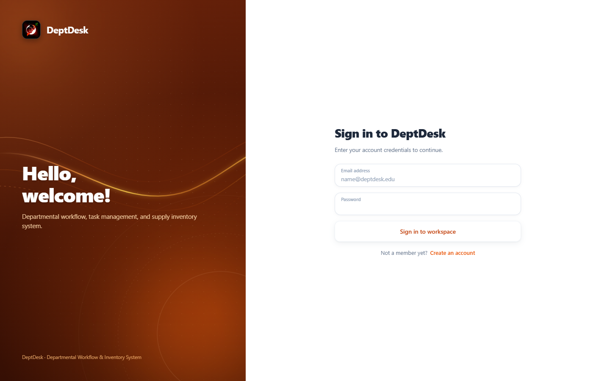
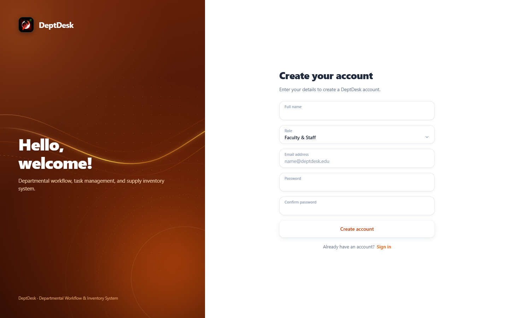

# DeptDesk (Department-Desk)

A React and Supabase web application for department office operations—tracking incoming and outgoing document transactions, managing supply and equipment inventory, and organizing role-based tasks.

## Preview

| Sign In | Role-Based Sign Up |
| :---: | :---: |
|  |  |

## Features

- **Role-Based Workspaces**: Tailored views and permissions for **Secretary**, **Dean**, and **Faculty & Staff**.
- **Dashboard**: Overview metrics, 5 most recent transactions, inventory alerts, and quick actions.
- **Transactions & Document Tracking**: Outgoing (`transactions_ongoing`) and incoming (`transactions_incoming`) document records with audit history (`transaction_history`), office routing, physical file locator (cabinet/drawer/section), search, filtering, and table/board/cabinet views.
- **Supply & Equipment Inventory**: Item masterlist, borrow/use/return logging, Secretary return confirmation workflow, low-stock alerts, usage statistics and charts, receipt previews, and a dedicated self-service portal for Faculty & Staff.
- **Task Management**: Owner-scoped tasks with priority levels, statuses, due dates, and table/board views.
- **Real-Time Updates & Notifications**: Live sync via Supabase Realtime (`postgres_changes`), header notifications with configurable alerts and sound mute, global search, light/dark theme, and table density settings.

## Roles & Permissions

| Role | Workspace Pages | Key Capabilities |
| :--- | :--- | :--- |
| **Secretary** (Main Administrator) | Dashboard, Transactions, Tasks, Inventory | Full transaction & document management, manage inventory masterlist & stock levels, confirm pending returns, manage own tasks |
| **Dean** (Supervisor) | Dashboard, Transactions, Tasks, Inventory | Monitor transactions and inventory (read-only on masterlist/documents), borrow/use/return supplies for self, manage own tasks |
| **Faculty & Staff** (Inventory Portal) | Staff Inventory, Tasks | Browse available supplies, log borrow/use/return requests, manage own tasks |

All roles also have access to **Profile**, **Settings**, and **Help**.

## Tech Stack

- **Frontend**: React 19 (`react-scripts` 5), CSS custom properties (light/dark themes)
- **Backend & Auth**: Supabase (`@supabase/supabase-js`) — Auth, PostgreSQL, Row Level Security (RLS), and Realtime
- **Testing**: Jest & React Testing Library

## Getting Started

### Prerequisites

- Node.js (LTS recommended) and npm
- A [Supabase](https://supabase.com) project

### 1. Install Dependencies

```bash
npm install
```

### 2. Configure Environment Variables

Create a `.env` file in the project root based on `.env.example`:

```env
REACT_APP_SUPABASE_URL=https://your-project-id.supabase.co
REACT_APP_SUPABASE_ANON_KEY=your-supabase-anon-key
```

> **Security note:** Only use your Supabase project's public anon/publishable key in this browser app. Never place a `service_role` key in client-side code or `.env`. Restart the dev server after editing `.env`.

### 3. Run the App

```bash
npm start       # Start development server at http://localhost:3000
npm test        # Run Jest / React Testing Library test suite
npm run build   # Create production build in build/
```

## Supabase Database Setup

The Supabase client is initialized in [`src/supabase/supabaseClient.js`](src/supabase/supabaseClient.js).

### Applying Migrations

See [`supabase/migrations/sql_table_ref.sql`](supabase/migrations/sql_table_ref.sql) for a reference overview of the schema (context only; not meant to be executed directly).

Apply the timestamped SQL migrations in `supabase/migrations/` in chronological order using the Supabase CLI or the Supabase SQL Editor:

1. **Auth & Role Setup** (`20261114170400` – `20261114221500`):
   - Trigger on `auth.users` creating a linked `public.users` row (`full_name` → `username`, `role`, `auth_user_id`).
   - Database-enforced role slot limits and the `get_signup_role_availability()` RPC (including unlimited Staff signups).
   - Syncs validated signup roles into `auth.users.raw_app_meta_data` so JWT claims carry `app_metadata.role`.
2. **Inventory & Tasks** (`20261115081300` – `20261116132900`, `20261117153000` – `20261117160000`):
   - Enables staff and dean inventory workflows, secretary return confirmations, and owner-scoped tasks.
3. **Transactions, Offices & File Locations** (`20261115222500` – `20261116140000`, `20261119144700`):
   - Splits outgoing (`transactions_ongoing`) and incoming (`transactions_incoming`) tables, connects forms/history, seeds default offices and cabinet/drawer file locations, and allows secretaries to add new offices.
4. **Security & Data Guards** (`20261120233000` – `20261121183000`):
   - Hardens RLS policies, staff return rules, stock validation guards, and MVP data constraints.

### Optional: Seed Sample Data

After creating at least one linked **Secretary** account, you can run [`supabase/seed_sample_data.sql`](supabase/seed_sample_data.sql) in the Supabase SQL Editor to populate idempotent sample inventory, transactions, and tasks.

## User Accounts & Auth Flow

- The login screen supports Supabase email/password sign-in and account creation.
- Sign-up collects a full name and workspace role, then returns to sign-in. If email confirmation is enabled in Supabase Auth, users must confirm their email before signing in.
- **Role Slot Limits**: Secretary signups are limited to **3**, Dean signups to **1**, and Faculty & Staff signups are **unlimited**. Limits are enforced in the database, and the signup form hides filled roles using `get_signup_role_availability()`.
- **Authorization**: The client resolves the active workspace from `app_metadata.role` (verified via JWT claims), while database Row Level Security (RLS) policies enforce actual data access. Cached workspace data in `localStorage` is cleared on sign-out.

## Project Structure

```text
├── public/                 # Static assets, manifest, DeptDesk logo & HTML shell
├── src/
│   ├── components/         # Shared UI primitives, Header (search & notifications), Sidebar
│   ├── constants/          # Roles, request statuses, system defaults
│   ├── hooks/              # Supabase data sync (useOfficeData), inventory actions, stored state
│   ├── layouts/            # AuthLayout & MainLayout
│   ├── pages/
│   │   ├── auth/           # Login & signup
│   │   ├── dashboard/      # Overview panels & recent transactions
│   │   ├── inventory/      # Admin inventory masterlist, records, charts, pending returns
│   │   ├── staff/          # Faculty & Staff inventory portal
│   │   ├── task-management/# Owner-scoped task tracker
│   │   ├── transactions/   # Incoming/outgoing document tracker & file cabinets
│   │   └── system/         # Profile, Settings, Help
│   ├── styles/             # Global theme & component stylesheets
│   ├── supabase/           # Supabase client initialization
│   └── utils/              # Formatters, search, header & inventory helpers
└── supabase/
    ├── migrations/         # Chronological SQL migrations & schema reference
    └── seed_sample_data.sql
```
